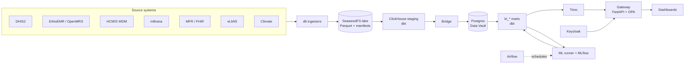

# Health Intelligence Center

A national health data platform. It ingests data from the source systems a ministry of health runs, stores it in an object lake, models it in a Data Vault warehouse with analytical marts, and serves it through a policy-enforced gateway to dashboards for decision makers, analysts, data stewards, operators and the public. Machine learning models for outbreak detection, early warning and supply forecasting run on the same warehouse.

The platform runs on Kubernetes. Source system replicas and the assistant model run alongside it as Docker Compose stacks. The repository ships with an Ethiopian country profile as the reference configuration, plus Zambian and Ghanaian profiles.

## Capabilities

- **Ingestion** from DHIS2 (HMIS and IDSR), an OpenMRS-based EMR, the HCMIS warehouse system, mBrana community stock reporting, a FHIR facility registry, eLMIS and a climate feed. Ingestors are built on dlt and land Parquet files with a manifest per run.
- **Warehouse.** ClickHouse staging over the lake, a Data Vault 2.0 layer in Postgres (AutomateDV, 223 models with generated tests) and `bi_*` marts for disease surveillance, service coverage, programme cascades, supply chain, workforce, data quality and governance.
- **Master and reference data.** An OMOP-style reference vocabulary, facility and commodity matching, and a maker-checker stewardship workflow whose decisions are applied to the vault on the next run.
- **Data access.** One gateway in front of the warehouse: Keycloak identity, an OPA decision per request (allow, row filter, column masking), audited exports, ad-hoc SQL with per-table policy checks, and k-anonymised public marts.
- **Machine learning.** Outbreak detectors, an early-warning model with climate covariates, and stock-out and consumption forecasting. Models are trained, registered and promoted through MLflow; batch prediction and drift checks are scheduled in Airflow.
- **Dashboards.** Internal BI with an LLM assistant, a public open-data portal, a workshop for analysts and researchers (projects, datasets, JupyterLab, model review), and an admin console (users and roles, data quality, master data stewardship, lineage, ML controls, cluster topology).
- **Governance.** OpenMetadata lineage, column classification, a data-quality detector with incidents and SLAs, and consent-aware marts.

## Architecture



Every read from the warehouse goes through the gateway. The gateway resolves the caller's identity, asks OPA for a decision, and applies the returned row filter and column masking before the query runs. See [docs/architecture.md](docs/architecture.md).

## Technology

| Layer | Components |
|---|---|
| Platform | Kubernetes (k3s, k3d locally), Cilium, Traefik, Helm, Ansible |
| Storage | SeaweedFS (S3), ClickHouse 24.3, PostgreSQL 16, Trino 476 |
| Pipeline | dlt 1.4, dbt-core 1.10 (dbt-clickhouse, dbt-postgres), AutomateDV, Airflow 2.10 |
| Access | FastAPI, Keycloak 26, OPA 1.5 |
| ML | MLflow, statsmodels, numpy, pandas, Ollama |
| Dashboards | React 18, TypeScript, Vite, Superset, JupyterHub, dbt docs |
| Operations | OpenMetadata, Prometheus, Alertmanager, Loki, Headlamp |

## Data

The platform runs on demonstration data. The source replicas are the real systems (DHIS2, HAPI FHIR, SQL Server, MySQL, PostgreSQL) or lightweight stand-ins, populated by the generators in this repository. [docs/data-provenance.md](docs/data-provenance.md) describes each source, what a fresh clone reproduces, and the time coverage of the data.

## Repository layout

Top-level directories are numbered in the order data moves through the platform.

| Directory | Contents |
|---|---|
| `0_external/` | Source system replicas and their seeders, the identity provider stand-in, the LLM service |
| `1_infrastructure/` | Kubernetes manifests (kustomize), Helm chart, Ansible provisioning, Argo CD application |
| `2_pipelines/` | Ingestors, staging, bridge, Data Vault and marts (dbt), MDM matcher, ML runner and registry |
| `3_storage/` | Postgres schemas, SeaweedFS operations, ClickHouse and Trino configuration |
| `4_monitoring/` | Dashboard definitions for metrics and logs |
| `5_orchestrator/` | Airflow image and DAGs |
| `6_access-points/` | API gateway, tool gate, dashboards, Superset, JupyterHub, dbt docs |
| `7_security/` | Keycloak realms and theme, OPA policies and compiler, security seed loaders |
| `bundle/` | Bring-up and seeding scripts, country profiles, seed packs, ML packages, operator console |
| `docs/` | Architecture, deployment, security, data and ML, data dictionary |

## Running locally

Requires Docker and k3d on Linux x86_64, and internet access on the first run.

```bash
./bootstrap.sh                          # full bring-up
./bootstrap.sh --rebuild-images         # rebuild service images first
./bootstrap.sh teardown                 # remove the cluster, keep source volumes
./bootstrap.sh teardown --wipe-sources  # also remove source data
```

The bring-up creates the cluster, installs Cilium, builds the images, applies the manifests, starts and seeds the source replicas, runs ingestion and the dbt pipeline, then seeds identities, roles, policies, models and workshop content. Dashboards are served at `*.127.0.0.1.nip.io`.

The HCMIS, mBrana and EthioEMR replicas restore from database artifacts, and the facility registry landing tables load from CSV files; these are distributed separately (`0_external/sources/*/sample-data/`, `bundle/seeds/sources/mfr/`).

For a hosted deployment, `1_infrastructure/ansible/site.yml` provisions k3s on one node or several, installs the Helm chart and runs the same seed stages. See [docs/deployment.md](docs/deployment.md).

With every component and the assistant model loaded, the system uses about 40 GB of RAM and runs on a single 16 vCPU node. An NVIDIA GPU is only needed for the larger assistant model.

## Country profiles

A profile in `bundle/profiles/<key>/` has three layers: presentation (copy, geography, branding), application security (people, roles, scopes) and data (which sources and generators feed the pipeline).

| Profile | Scope |
|---|---|
| `et-v3` | Ethiopia, the reference configuration |
| `zm-v1` | Zambia, supply chain control tower on eLMIS |
| `gh-v1` | Ghana, presentation layer |

[docs/profile-swappability.md](docs/profile-swappability.md) covers what each layer controls and what remains country-specific.

## Documentation

| Document | Contents |
|---|---|
| [Architecture](docs/architecture.md) | Components, data path, access control |
| [Deployment](docs/deployment.md) | Bring-up, hosted deployment, packaging, observability |
| [Security](docs/security.md) | Realms, identity providers, OPA, masking, tool SSO |
| [Data and ML](docs/data-and-ml.md) | Marts, reference and master data, dashboards, models |
| [Data provenance](docs/data-provenance.md) | Sources and generators |
| [Data dictionary](docs/data-dictionary.md) | Programmes, indicators, commodities and marts |
| [Metadata](docs/metadata-plane.md) and [data quality](docs/data-quality-plane.md) | Lineage, classification, DQ detector and incidents |
| [CI](docs/ci-cd.md) | Test and deployment workflows |

Internal identifiers (the `nhdw` namespace, image and database prefixes) predate the current name and are kept for compatibility.
