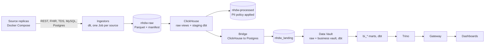

# Architecture

Data flows from the source systems through the lake and warehouse to the marts. Every read from the warehouse goes through the gateway.

## Data path

**Sources.** The source replicas run outside the cluster as Docker Compose stacks and are reached from pods through `host.k3d.internal`:

| Source | System | Protocol |
|---|---|---|
| DHIS2 | DHIS2 2.40 (aggregate HMIS and IDSR) | Web API |
| EthioEMR | OpenMRS schema on MySQL 8 | MySQL |
| HCMIS WDM | EPSS warehouse schema on SQL Server | TDS |
| mBrana | community stock reporting schema on SQL Server | TDS |
| MFR | HAPI FHIR R4 facility registry | FHIR |
| eLMIS | OpenLMIS v2 history on PostgreSQL 16 | PostgreSQL |
| Climate | weekly climate series behind a small HTTP API | HTTP |

See [data-provenance.md](data-provenance.md) for how each replica is populated.

**Ingestion.** Each source has its own ingestor (`2_pipelines/ingestor/<source>`), built on dlt, run as a Kubernetes Job. Ingestors are incremental where the source allows it (cursor state per table; the MFR facility registry is pulled in full each run), write Parquet to the `nhdw-raw` bucket on SeaweedFS and finish each run with a manifest that records what was written. The raw layer is untyped; typing happens in staging.

**Staging.** ClickHouse reads the lake through `s3()` views. The staging dbt project (`2_pipelines/staging`) deduplicates and types the raw records and computes record hashes; `build_processed_zone.py` writes a PII-filtered copy to `nhdw-processed` according to `pii_policy.yaml`.

**Vault.** The bridge (`2_pipelines/vault/bridge`) copies staged tables into Postgres `nhdw_landing`. The vault dbt project builds an insert-only Data Vault with AutomateDV: hubs, links and satellites per source, a business vault with resolution views over the reference vocabulary and the MDM decision log, and current-state views. Relationship and uniqueness tests are generated for every hub, link and satellite (`2_pipelines/vault/scripts/gen-vault-tests.py`).

**Marts.** The marts dbt project (`2_pipelines/marts`) builds the `bi_*` serving schemas from the vault: disease surveillance, HMIS coverage, programme cascades, supply chain and control tower, facilities and workforce, data quality, governance, public open data (k-anonymised) and ML inputs. `publish_public_datasets.py` exports the public marts as CSV with a catalogue.

**Machine learning.** The ML runner (`2_pipelines/ml/runner`) trains model packages from `bundle/seed-pack/app/ml/` on the marts, logs and registers them in MLflow, and writes batch predictions to `ops_ml.ml_predictions`, which the gateway serves. Airflow schedules batch prediction and drift checks; the admin console can trigger retraining and promotion.

**Master and reference data.** A separate lane resolves entities across sources: the reference vocabulary (`nhdw_ref`, built from the entity model and curated supplements) and the MDM matcher (`2_pipelines/mdm`), whose candidates stewards review in the admin console. Accepted decisions re-key records onto their masters on the next vault build.

## Access

The gateway (`6_access-points/api/nhdw-gateway`, FastAPI) is the only path from the dashboards to the warehouse. For every request it resolves the caller from the Keycloak token, builds a decision request (subject, data class, granularity, verb, classified columns) and asks OPA. OPA returns allow or deny, a row filter for the caller's geography and programme scope, and the columns to mask. The gateway applies both before the query reaches Trino. Widget data, exports, ad-hoc `SELECT` queries and the assistant's tools go through the same decision.

Dashboards are assembled from a widget catalogue, and roles are granted widgets and pages. Country profiles can remove entries from the catalogue but not add grants.

Analyst and operator tools (Superset, JupyterHub, Airflow, MLflow, dbt docs, Prometheus, Alertmanager, Headlamp, the SeaweedFS console) are reached through Keycloak single sign-on, either with their own OIDC support or behind the role-aware tool gate (`6_access-points/api/tool-gate`). See [security.md](security.md).

## Runtime

| Concern | Implementation |
|---|---|
| Cluster | k3s (hosted) or k3d (local); Cilium with Hubble for networking and flow visibility |
| Ingress | Traefik with TLS; one host per surface under a configurable host base (`*.127.0.0.1.nip.io` locally) |
| Object storage | SeaweedFS (S3 API): raw, processed, artifacts, static, backups, logs, docs buckets |
| Databases | Postgres (vault, landing, marts, operational schemas `ops_*`), ClickHouse (staging), Trino (query federation for the gateway and Superset) |
| Identity and policy | Keycloak (staff, privileged-operator and partner realms), OPA (policies compiled from role definitions) |
| Orchestration | Airflow DAGs for prediction, drift, data quality, alert evaluation, metadata ingestion and pipeline refresh |
| Metadata | OpenMetadata (catalogue and lineage), with lineage emitted by the ingestors and dbt jobs |
| Observability | Prometheus, Alertmanager, Loki and Promtail, metrics-server; the admin console's topology view reads them |
| Assistant | External Ollama service, selected by `bundle/scripts/gpu-detect.sh` |

The deployable definition exists as a kustomize tree (`1_infrastructure/k8s`, used by `bootstrap.sh`) and as a Helm chart (`1_infrastructure/helm/nhdw`, used by the Ansible roles and Argo CD).
